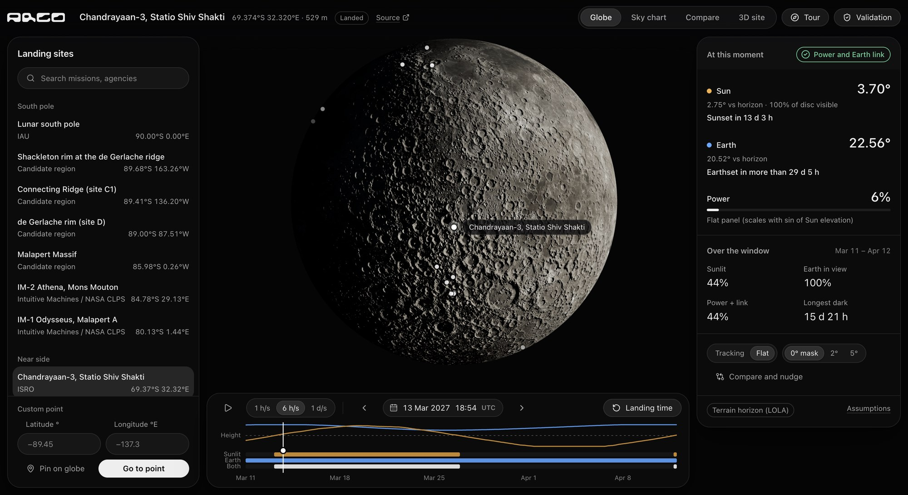
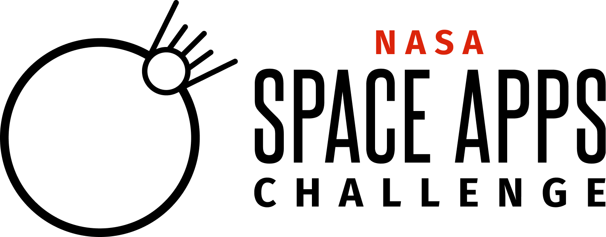

<p align="center">
  <picture>
    <source media="(prefers-color-scheme: dark)" srcset="docs/media/argo-logo-dark.png">
    
  </picture>
</p>

<p align="center"><b>Lunar Landing Site Navigator</b><br>
Will the panel get sunlight, and will Earth be in view? For any site on the Moon, on any date.</p>

<p align="center">
  <a href="https://argo-4eg.pages.dev"><b>Open the app</b></a> ·
  <a href="https://drive.google.com/file/d/1UBb8laYB5ZrqTQVDsRBuV6blmLT2zfZ4/view?usp=sharing"><b>Watch the 30 s demo</b></a> ·
  NASA Space Apps Challenge 2026
</p>

<p align="center">
  <a href="https://argo-4eg.pages.dev"></a>
</p>

## What it does

Near the lunar south pole the Sun stays within about 1.6° of a flat horizon, so a ridge a few kilometres away can decide whether a lander has power. Argo traces the real horizon around a site and tells you, at any moment and over the first 30 days after touchdown, whether the solar panel is lit and whether Earth is above the horizon for direct radio contact.

- **Landing sites:** 20 sites, from south pole candidates (Shackleton rim, Connecting Ridge, de Gerlache rim, Malapert Massif) to Apollo, Chandrayaan-3, Chang'e, SLIM and Intuitive Machines. You can also type any latitude and longitude, or drop a pin on the globe.
- **At this moment:** Sun and Earth elevation above the local horizon, panel power, Earth link, and time to the next sunset or Earthset.
- **Timeline:** sunlight, Earth in view and both together across the landing window. Scrub it or play it.
- **Sky chart:** the Sun and Earth tracks drawn over the site's horizon silhouette, with a table view of the exact angles.
- **3D site:** 20 × 20 km of LOLA terrain, lit from the Sun's true direction, with Earth where it really is.
- **Compare and Nudge:** up to three sites or dates scored over 30 days. Nudge tests 16 spots within 2 km and landings up to 3 days earlier or later.
- **Validation:** the engine checked against NASA JPL Horizons, inside the app.

Every scenario lives in the URL, so any result can be shared as a link.

## How it works

| Part | Method |
|---|---|
| Sun and Earth positions | [astronomy-engine](https://github.com/cosinekitty/astronomy), IAU Moon rotation with libration, topocentric (parallax and observer height) |
| Horizon | 720 azimuths every 0.5°, marched out to 200 km over LOLA elevation (40 m near the site, 240 m beyond), with lunar curvature |
| Visibility | Sun and Earth treated as discs, so power scales with how much of the Sun clears the ridge |
| 3D | three.js shadow map over the baked tile, plus the far horizon for terrain beyond 10 km |
| Metrics | 10-minute samples over 30 days: power + link hours, first unbroken window, longest dark |

**Validation:** 110 JPL Horizons cases (DE441) at 9 sites and 6 dates. Largest error 0.0033°, mean 0.0021°. The Sun's radius is about 0.27°. The Apollo 11 landing moment matches Horizons to 0.001°.

The full maths is in [docs/LOGIC.md](docs/LOGIC.md), and the data sources are in [docs/DATA.md](docs/DATA.md).

## Data

- **NASA LRO LOLA:** polar elevation models LDEM_80S_40M, LDEM_75S_240M and LDEM_60S_60M ([PDS](https://pds-geosciences.wustl.edu/lro/lro-l-lola-3-rdr-v1/lrolol_1xxx/data/lola_gdr/polar/img/))
- **SLDEM2015:** LOLA + JAXA Kaguya, for sites away from the pole
- **NASA JPL Horizons:** [validation](https://ssd.jpl.nasa.gov/horizons/)
- **NASA SVS CGI Moon Kit** and **Blue Marble:** globe textures
- **NSSDC and LROC:** landing site coordinates

## Run it

```bash
npm install
npm run dev      # http://localhost:5173
npm test         # engine, metrics and URL tests (Vitest)
npm run build
```

Terrain and horizons are baked offline into `public/data` by `python3 tools/bake.py`. The raw LOLA files go in `data-raw/`, which is not committed.

## Stack

- **App:** TypeScript, React, Vite
- **3D:** three.js with React Three Fiber
- **Animation and state:** GSAP, Zustand
- **Astronomy:** astronomy-engine
- **Data baking:** Python with NumPy and Pillow
- **Tests:** Vitest
- **Hosting:** Cloudflare Pages

## Team

- **K Jaidev Shankar Reddy**
- **Advik R Holalu**

<br>

<p align="center">
  <picture>
    <source media="(prefers-color-scheme: dark)" srcset="docs/media/argo-logo-dark.png">
    
  </picture>
  &nbsp;&nbsp;&nbsp;&nbsp;
  <picture>
    <source media="(prefers-color-scheme: dark)" srcset="docs/media/spaceapps-white.png">
    
  </picture>
</p>

<p align="center"><sub>Built for the 2026 NASA Space Apps Challenge · Lunar Landing Site Navigator</sub></p>
